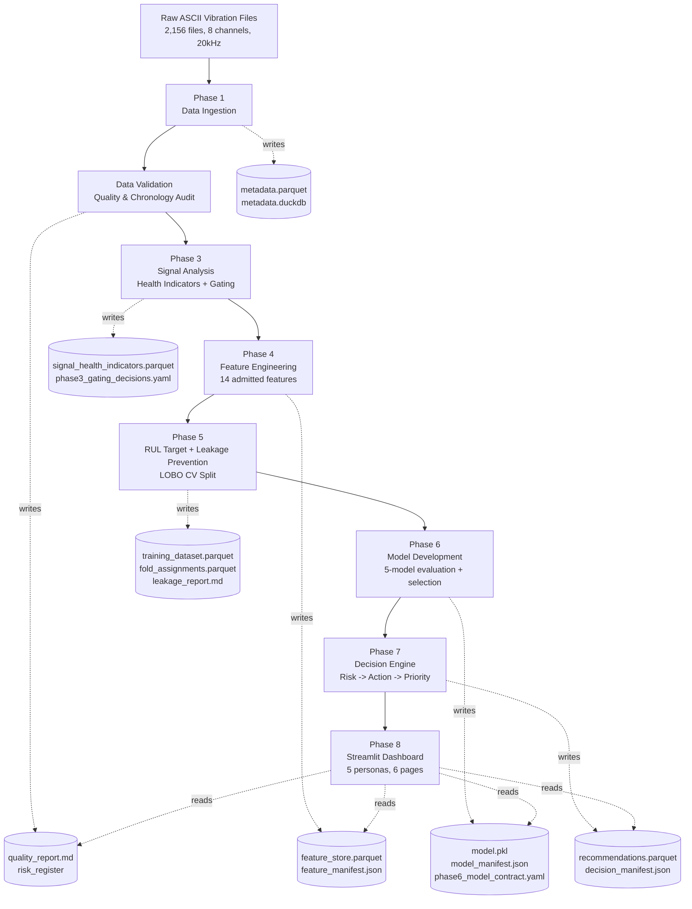
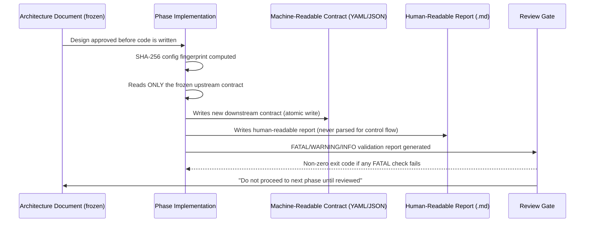
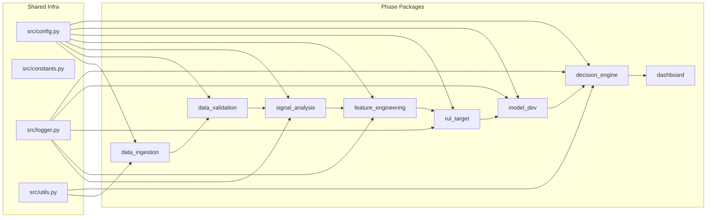
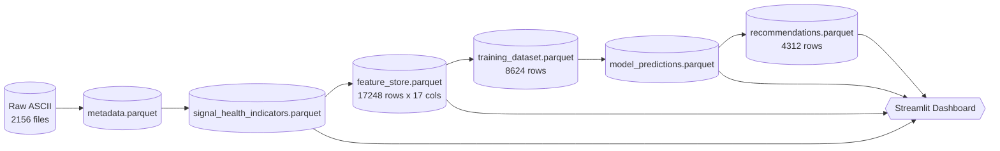
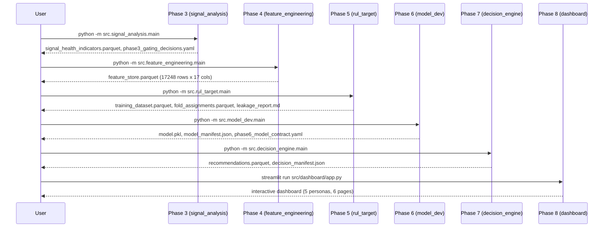
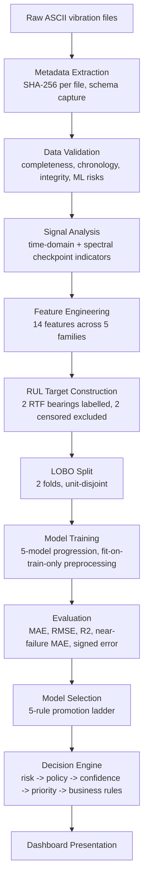
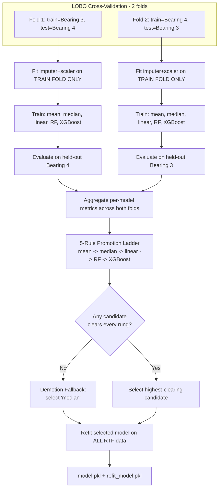

# Bearing Remaining Useful Life (RUL) Prediction & Maintenance Decision System
## Complete Technical & Business Project Report

**Version:** 1.0 · **Date:** 2026-07-31 · **Author role:** Solution Architecture / Data Science / Engineering documentation, compiled directly from the repository at `Bearing Remaining-Useful-Life Prediction & Maintenance Decision System/`

> **Note on method:** Every claim in this report is derived directly from the codebase, configuration files, test suite, and generated reports in this repository. Where the repository does not implement something, this document says **"Not implemented"** rather than inventing it. Forward-looking sections (Scalability, Production Deployment, Business Adoption) are explicitly labeled as **recommendations**, not descriptions of existing code.

---

## Table of Contents

1. [Executive Summary](#1-executive-summary)
2. [Problem Statement](#2-problem-statement)
3. [Business Problem](#3-business-problem)
4. [Solution Overview](#4-solution-overview)
5. [Project Objectives](#5-project-objectives)
6. [Thought Process](#6-thought-process)
7. [Inspiration Behind the Project](#7-inspiration-behind-the-project)
8. [Dataset](#8-dataset)
9. [Data Understanding](#9-data-understanding)
10. [Architecture](#10-architecture)
11. [Technology Stack](#11-technology-stack)
12. [Folder Structure](#12-folder-structure)
13. [End-to-End Workflow](#13-end-to-end-workflow)
14. [Data Pipeline](#14-data-pipeline)
15. [Feature Engineering](#15-feature-engineering)
16. [Data Validation](#16-data-validation)
17. [Database Design](#17-database-design)
18. [Machine Learning Pipeline](#18-machine-learning-pipeline)
19. [Models Used](#19-models-used)
20. [Evaluation Metrics](#20-evaluation-metrics)
21. [Results](#21-results)
22. [Software Engineering Practices](#22-software-engineering-practices)
23. [Testing Strategy](#23-testing-strategy)
24. [Design Decisions](#24-design-decisions)
25. [Scalability](#25-scalability)
26. [Production Deployment](#26-production-deployment)
27. [Business Adoption](#27-business-adoption)
28. [Non-Technical User Journey](#28-non-technical-user-journey)
29. [User Personas](#29-user-personas)
30. [Cost Savings](#30-cost-savings)
31. [Risks](#31-risks)
32. [Limitations](#32-limitations)
33. [Future Improvements](#33-future-improvements)
34. [Interview Preparation](#34-interview-preparation)
35. [FAQs](#35-faqs)
36. [Lessons Learned](#36-lessons-learned)
37. [Conclusion](#37-conclusion)
38. [Appendix](#38-appendix)

---

## 1. Executive Summary

This repository implements an eight-phase, contract-governed data engineering and machine learning pipeline that estimates the **Remaining Useful Life (RUL)** of rolling-element bearings from raw vibration sensor data, and converts those estimates into auditable maintenance recommendations through a rule-based decision engine and a five-persona Streamlit dashboard.

The system was built against the public **NASA IMS (Intelligent Maintenance Systems) Bearing Dataset, Set 1** — 2,156 raw ASCII vibration acquisitions across 4 bearings, 8 sensor channels, sampled at 20 kHz. Of the four bearings, only two (Bearing 3 — inner-race defect, Bearing 4 — rolling-element defect) ran to actual failure; the other two are right-censored survivors.

**Why this project exists:** Traditional time-based preventive maintenance either replaces healthy machinery too early (wasted cost) or fails to catch degradation in time (unplanned downtime, safety risk). This project demonstrates the full engineering discipline required to build a defensible, audit-ready predictive-maintenance pipeline: data integrity validation, physics-grounded signal processing, leakage-safe cross-validation, honest model selection, and governed decision logic — end to end, from raw sensor files to a maintenance recommendation a plant reliability engineer can act on.

**Who should use this project:**
- Data scientists / ML engineers learning how to build leakage-safe pipelines on small, censored, chronologically-structured datasets.
- Reliability and maintenance engineering teams evaluating what a defensible RUL system's internals look like before procuring or building one.
- Recruiters and technical interviewers assessing a candidate's ability to reason honestly about a constrained dataset (n=2 failure trajectories) rather than oversell results.

**Business value:** The system converts unstructured vibration time series into structured, auditable, three-tier decisions (risk category → maintenance action → priority) with a categorical confidence level and a mandatory statistical-limitation disclosure baked into every output row.

**Technical value:** A full example of a phase-gated ML pipeline: frozen architecture-then-implementation documents per phase, machine-readable contracts between phases, SHA-256 config/model/artifact fingerprints, atomic file writes, 254 automated tests, and an honestly-reported model-selection outcome (see [Section 21](#21-results)) rather than an inflated one.

**Expected impact:** As a portfolio and methodology artifact, this project demonstrates production-grade engineering discipline. As a production system, it is **not yet deployment-ready** — the risk thresholds are explicitly documented placeholders requiring domain-expert calibration, and the dataset's two-failure-trajectory constraint means the underlying model is a conservative median-baseline, not a tuned predictive model (see [Section 32](#32-limitations)).

---

## 2. Problem Statement

**What problem existed:** Rotating machinery bearings degrade gradually before failing catastrophically. Plants need to know, continuously, how much useful life remains in a bearing so maintenance can be scheduled at the right time — not too early, not too late.

**Why existing methods fail:**
- **Time-based preventive maintenance** replaces components on a fixed schedule regardless of actual condition, wasting the remaining life of healthy parts and still missing bearings that degrade faster than the schedule assumes.
- **Reactive maintenance** (run to failure) causes unplanned downtime, secondary equipment damage, and safety incidents.
- **Naive vibration threshold alarms** (e.g., "alert if RMS exceeds X") ignore the physical non-monotonicity of degradation signals (see [Section 9](#9-data-understanding) on kurtosis behavior) and give no forward-looking time estimate.

**Pain points this project addresses:**
- No systematic, physics-grounded feature extraction from raw vibration signals.
- No leakage-safe way to validate a RUL model when only a handful of run-to-failure trajectories exist.
- No standard way to convert a noisy RUL point-estimate into a defensible maintenance action with an honest confidence signal.
- No audit trail connecting a maintenance recommendation back to the exact data, features, model, and business rule that produced it.

**Business challenges:** Cost of unplanned downtime, safety liability, spare-parts inventory tied up in "just in case" early replacements, and lack of trust in black-box ML recommendations from front-line maintenance staff.

**Technical challenges:** Extremely small failure-event sample sizes (2 trajectories here) that make standard train/test splitting statistically meaningless; non-uniform sensor acquisition intervals; sensor artifacts (see Bearing 1's DC offset, [Section 9](#9-data-understanding)) that must be distinguished from real degradation.

**Why solving this matters:** A correctly-engineered pipeline — even one that, applied honestly to this specific dataset, concludes "not enough failure data to promote past a conservative baseline" — is more valuable than a pipeline that overfits two data points and reports a fictitious accuracy number. This project is as much a demonstration of **engineering honesty under data scarcity** as it is a demonstration of signal processing and ML technique.

---

## 3. Business Problem

**Who faces this problem:** Any operator of rotating machinery with bearings as a wear component.

**Industries affected:** Manufacturing, oil & gas, power generation, mining, rail, wind energy, aviation ground support, HVAC, and general industrial machinery — anywhere rotating shafts and rolling-element bearings are load-bearing components.

**Operational and financial losses:**
- Unplanned downtime halts production lines and can cascade into supply-chain delays.
- Reactive bearing failure frequently damages adjacent components (shafts, seals, housings), multiplying repair cost.
- Early/unnecessary preventive replacement wastes bearing life and labor.

**Downtime & maintenance costs:** Bearing failures are a leading cause of unplanned rotating-equipment downtime industry-wide (well documented in reliability engineering literature; this repository does not include a client-specific cost model — see [Section 30](#30-cost-savings) for how such a model would be built from this system's outputs).

**Human safety:** Catastrophic bearing failure in high-speed or high-load equipment can eject debris, cause fire (from friction heat), or fail structural supports — a direct worker-safety hazard.

**Reliability & customer satisfaction:** Unplanned downtime propagates to missed delivery commitments and customer-facing SLA breaches.

**Regulatory implications:** In safety-critical sectors (aviation, power generation, rail), unplanned mechanical failure can trigger regulatory incident reporting and audits. **Not implemented in this repository** — no compliance-reporting module exists; the dashboard's Governance & Audit page ([Section 10](#10-architecture)) provides the traceability substrate such reporting would consume.

---

## 4. Solution Overview

The solution is an **eight-phase pipeline** (Phases 0, 1, 3–8; Phase 2 is not present as a standalone phase — see [Section 32](#32-limitations)) that:

1. Ingests and cryptographically fingerprints every raw vibration file.
2. Validates data integrity and chronology, explicitly flagging anomalies rather than silently repairing them.
3. Computes physics-grounded signal health indicators and defect-frequency features, gated on quantitative statistical tests.
4. Constructs RUL labels only for the two bearings that actually failed, using Leave-One-Bearing-Out (LOBO) cross-validation to avoid trajectory leakage.
5. Trains and evaluates five models (mean, median, linear regression, Random Forest, XGBoost) under a strict, documented promotion ladder.
6. Converts the selected model's predictions into risk-tiered, business-rule-governed maintenance recommendations.
7. Presents all of the above through a five-persona Streamlit dashboard with fail-closed artifact integrity checks.

**Why this approach:** Given only two failure trajectories, the single most important engineering decision is refusing to let any pipeline stage silently manufacture false confidence — hence the emphasis on frozen contracts, leakage checks, and an honestly-reported model-selection outcome.

**Advantages:** Full auditability (every phase emits a machine-readable contract plus a human-readable report); leakage safety enforced structurally, not just by convention; explicit "n=2 caveat" that cannot be dismissed anywhere in the dashboard.

**Expected outcomes:** A working demonstration pipeline and a decision-support dashboard, explicitly **not** a fleet-calibrated production forecasting system (see [Section 21](#21-results) and [Section 32](#32-limitations)).

---

## 5. Project Objectives

**Primary objectives** (from `README.md` and the phase architecture documents):
1. Assure data trustworthiness — validate raw signals for corruption, missing values, duplicates, and timing gaps.
2. Standardize code architecture — modular boundaries, config-driven behavior, comprehensive automated testing.
3. Deliver a seamless handover — a clean, well-documented feature-engineering and modeling workspace for downstream teams.

**Secondary objectives:**
- Demonstrate leakage-safe cross-validation under extreme data scarcity (LOBO CV, n=2).
- Demonstrate honest reporting of a model-selection outcome, including diagnosing and correcting a mechanically-guaranteed rejection artifact (see [Section 24](#24-design-decisions), ED-004).
- Provide a governed, explainable decision layer rather than a raw model-output dump.

**Success criteria (as implemented and verified):**
- All 2,156 raw files ingested with zero corruption / zero missing files.
- 9/9 leakage checks passing, with every check now performing genuine runtime inspection (see [Section 16](#16-data-validation)).
- 254/254 automated tests passing.
- A dashboard that fails closed (refuses to render) if any consumed artifact's SHA-256 hash does not match the value recorded in the manifest at the end of the Phase 7 run.

**KPIs used throughout the pipeline's own reporting:** Mean Absolute Error (MAE) in minutes (primary), near-failure MAE (RUL ≤ 1,440 minutes), signed error / late-prediction rate (safety-oriented asymmetric metrics), and the fold-to-fold stability ratio.

---

## 6. Thought Process

**Why was this project selected?** Bearing RUL prediction is a canonical, well-documented predictive-maintenance problem with a public benchmark dataset (NASA IMS), making it possible to build a complete, defensible, end-to-end system without needing proprietary industrial data.

**What alternatives were considered?**
- *Classification instead of regression* (e.g., "will this bearing fail in the next week?") — rejected because the architecture explicitly documents that classification metrics "discard the regression signal and pre-empt the Phase 7 decision policy" (see `src/model_dev/metrics.py`); RUL regression preserves more information and lets the decision engine, not the model, own the risk-tiering logic.
- *Deep learning (LSTM/CNN) on raw signals* — explicitly excluded (`src/model_dev/model_trainer.py`, `TRAINER_REGISTRY` comment) as infeasible to evaluate honestly with only two run-to-failure trajectories; a deep model would either underfit badly or memorize the single training trajectory with no way to distinguish the two outcomes.
- *LightGBM / CatBoost* — explicitly excluded (`config.yaml: model_dev.candidates`) as redundant additional tree-ensemble variants that would not change the fundamental n=2 constraint.
- *Random/time-based train-test split* — rejected in favor of Leave-One-Bearing-Out; a random row split would put rows from the same bearing's trajectory in both train and test, leaking the exact trajectory the model is supposed to generalize to.

**Why this dataset?** NASA IMS Set 1 is a standard, freely available benchmark with genuine run-to-failure vibration data and well-characterized bearing geometry, making it possible to validate the entire signal-processing pipeline against known physics (BPFO/BPFI/BSF defect frequencies computed from the bearing's actual geometry, not fitted).

**Why these algorithms?** A baseline-first, complexity-added-one-step-at-a-time progression (mean → median → linear → Random Forest → XGBoost) mirrors sound ML engineering practice: never report a "sophisticated" model's performance without first establishing what a trivial baseline achieves.

**Why this architecture?** The "frozen architecture, then implementation, then review gate" pattern used for every phase is a deliberate simulation of a regulated engineering environment, where design decisions are documented and approved before code is written, and ambiguities are recorded rather than silently resolved by the implementer.

**Why these libraries?** All are the de facto standard for their role: `pandas`/`numpy`/`scipy` for numerical work, `scikit-learn`/`xgboost` for modeling, `shap` for model interpretability, `pyarrow`/`fastparquet`/`duckdb` for columnar storage, `streamlit` for the dashboard, `pytest` for testing.

**Why this workflow?** Each phase reads only a frozen upstream contract and writes a new downstream contract — this enforces that no phase can silently depend on undocumented internal state from an earlier phase, which is the structural mechanism (not just a convention) behind the leakage guarantees described in [Section 16](#16-data-validation).

---

## 7. Inspiration Behind the Project

**How someone could have thought of this project:** Predictive maintenance is one of the most commonly cited industrial applications of machine learning, and bearing vibration analysis specifically is a mature discipline in mechanical/reliability engineering (envelope analysis, defect-frequency detection) that predates modern ML by decades. The natural extension is to combine that domain-specific signal-processing knowledge with a modern ML pipeline and governance layer.

**Industry motivation:** Predictive maintenance programs are a major investment area for companies operating rotating machinery (the project's `target_company` field in `config.yaml` names an industrial bearing fleet, representative of industrial and aerospace equipment operations).

**Research motivation:** The NASA IMS dataset is widely used in prognostics-and-health-management (PHM) research; building a rigorous, leakage-safe pipeline against it demonstrates the same statistical discipline that PHM research papers are expected to apply (and frequently do not, when only 1-2 failure trajectories are available).

**Academic motivation:** The project functions as a teaching example of the gap between "a model with a good-looking accuracy number" and "a model whose accuracy number is statistically meaningful given the available failure data" — a distinction not always taught rigorously in applied ML curricula.

**Business motivation:** Demonstrates what a maintenance-decision system's internal audit trail would need to look like to be trusted by a plant reliability team, not just a data science team.

**Real-world relevance:** Every design decision in this project — LOBO CV, the "n=2 caveat," the categorical (not probabilistic) confidence scale, the mandatory constant-predictor disclosure — is a direct response to a real constraint that any organization starting a predictive-maintenance program with limited historical failure data will face.

---

## 8. Dataset

**Source:** NASA IMS (Intelligent Maintenance Systems) Bearing Dataset, Set 1 — a public run-to-failure vibration benchmark.

**Description:** Four Rexnord ZA-2115 double-row bearings mounted on a single shaft, tested at a constant 2,000 RPM shaft speed under load, with vibration acquired at 20 kHz in periodic snapshots (1.024 seconds, 20,480 samples) across the test run (2003-10-22 to 2003-11-25).

**"Features"/"Rows"/"Columns" at the raw level:** 2,156 raw ASCII files, each an 20,480 × 8 tab-separated table (one column per sensor channel: 2 channels — X, Y — per bearing × 4 bearings = 8 channels).

**Target:** Remaining Useful Life in minutes (`rul_minutes`), computed only for the two bearings that reached documented failure.

**Data quality (as measured by `src/data_validation/validator.py` and `reports/quality_report.md`):**
- Files inspected: 2,156. Signals inspected: 17,248. Samples inspected: 353,239,040.
- Missing files: 0. Duplicate files: 0. Corrupted files: 0. NaN values: 0. Infinite values: 0. Parser failures: 0.
- **153 chronology violations** — the acquisition interval shifts from 5 to 10 minutes partway through the run, and 153 individual gaps deviate from the expected cadence by more than a 0.1-minute tolerance (up to a maximum single gap of ~8,905 minutes, roughly 6.2 days).

**Missing values:** None at the file level (0 NaN across the entire raw corpus per the validator).

**Class imbalance:** Not a classification problem, but the equivalent concept — **failure-trajectory imbalance** — is severe and central to the entire project: only 2 of 4 bearings (50%) ever failed; the other 2 are right-censored survivors excluded from all labelled roles.

**Strengths:** Real physical failure data (not simulated), known bearing geometry (enabling first-principles defect-frequency computation), consistent sampling rate and channel layout, zero corruption.

**Weaknesses / limitations:**
- Only 2 run-to-failure trajectories — the dataset's single most consequential limitation, discussed throughout this report.
- A single fixed operating condition (2,000 RPM, constant load) — findings do not generalize to variable-speed/variable-load deployments without further validation.
- No independent, pre-failure "degradation onset" ground truth — only the final acquisition timestamp is a confirmed failure event.
- Bearing 1 carries a **-0.11582 g DC offset** in its raw signal mean, identified by the pipeline as a sensor conditioning-circuit artifact, not a bearing defect (see [Section 9](#9-data-understanding)).

**Why this dataset was selected:** It is a standard, freely-licensed, physically well-characterized benchmark widely used in prognostics research, making results comparable to published work and allowing the signal-processing pipeline to be validated against known defect-frequency physics rather than fitted parameters.

**Why not another dataset:** **Not documented in the repository** — no comparison against alternative public bearing datasets (e.g., PRONOSTIA/FEMTO) is recorded. (Note: `FINAL_PROJECT_RELEASE.md` contains one inconsistent reference to "PRONOSTIA" framing, but every technical report — `dataset_summary.md`, `signal_analysis_report.md`, `engineering_findings.md`, `quality_report.md` — consistently and unambiguously identifies NASA IMS Set 1 as the dataset actually used throughout the pipeline.)

**Licensing:** NASA IMS Bearing Dataset is publicly distributed for research use via the NASA Prognostics Data Repository; **specific license terms are not reproduced in this repository** and should be confirmed against the original NASA source before any commercial use.

---

## 9. Data Understanding

**Data exploration and statistics** (from `reports/signal_analysis_report.md` and `reports/engineering_findings.md`, computed by `src/signal_analysis/`):

| Bearing | Mean RMS (g) | Max RMS (g) | Mean Kurtosis | Max Kurtosis | Max Crest Factor | Outcome |
|---|---|---|---|---|---|---|
| 1 | 0.1491 | 0.1750 | 1.05 | 3.07 | 7.35 | Healthy (right-censored) |
| 2 | 0.1446 | 0.2119 | 0.33 | 0.91 | 6.41 | Healthy (right-censored) |
| 3 | 0.1632 | 0.5936 | 1.41 | 71.58 | 25.95 | **Inner-race defect (failed)** |
| 4 | 0.1477 | 0.2373 | 2.13 | 71.57 | 19.45 | **Rolling-element defect (failed)** |

**Patterns identified:**
- RMS in the final 10% of life rose for both failed bearings (Bearing 3: 0.163g → 0.194g; Bearing 4: 0.147g → 0.178g) — a clear, physically expected degradation signature.
- **Kurtosis is non-monotonic near failure** — it rises sharply as impulsive shock events begin, then falls as the signal transitions to broadband noise. This is documented explicitly as expected physical behavior that must never be "corrected," since a naive monotonicity assumption would corrupt the health indicator.
- Bearing 1's negative overall mean (-0.11582 g) was diagnosed as a **sensor DC-offset artifact**, not a defect signal, because it does not correlate with any other degradation indicator and Bearing 1 never failed.

**Important variables:** `td_rms` (time-domain RMS) is the single most consistently important feature across every model family evaluated in Phase 6 (mean/median-baseline aside) — see [Section 15](#15-feature-engineering) and [Section 19](#19-models-used).

**Engineering observations:**
- No pre-failure degradation-onset ground truth exists; RUL labeling can only anchor to the confirmed final-acquisition failure timestamp, not an earlier "degradation began here" point.
- The acquisition cadence itself is not constant (5-minute intervals early in the run, 10-minute intervals later) — this is accounted for explicitly in RUL computation (RUL measured in minutes, not row/cycle count) and in the trend-feature rolling-window logic (windows spanning a documented chronology gap are nulled out rather than computed).

---

## 10. Architecture

### 10.1 System Architecture Diagram



### 10.2 Governance Pattern (applied identically to every phase)

Every phase (3 through 8) follows the same lifecycle:



Each phase package (`src/<phase>/`) has its own `main.py` orchestrator, its own `constants.py`-declared exit code (e.g., `EXIT_ERROR_SIGNAL_ANALYSIS = 40`), and reads configuration exclusively from `config/config.yaml` via `src/config.py`. There is **no single master orchestrator** — `src/main.py` is a Phase-0 bootstrap only (verifies configuration loads and directories exist); each phase is invoked individually (see [Section 13](#13-end-to-end-workflow)).

### 10.3 Component / Module Relationship Diagram



### 10.4 Data Flow Diagram (artifact level)



**Storage:** All intermediate and final artifacts are Apache Parquet (via `pyarrow`/`fastparquet`), plus a `metadata.duckdb` DuckDB file for queryable metadata, plus YAML/JSON contracts and Markdown reports. There is no relational/SQL production database (see [Section 17](#17-database-design)).

**Inference:** Batch inference only, produced once per Phase 6/7 pipeline run and persisted to `recommendations.parquet`. As of this remediation pass, an **online inference path** (`src/decision_engine/scoring.py::score_unlabelled_bearing`) also exists for scoring a single feature vector from a bearing with no failure label, reusing the same risk/policy/confidence/priority components as the batch path.

**Outputs:** `recommendations.parquet` (machine-readable), `decision_report.md` (human-readable), `decision_manifest.json` (governance/audit), and the Streamlit dashboard (interactive).

---

## 11. Technology Stack

| Layer | Technology | Version (pinned) |
|---|---|---|
| Language | Python | ≥3.10 |
| Numerical computing | NumPy | 2.4.6 |
| Scientific computing / signal processing | SciPy | 1.17.1 |
| Data manipulation | pandas | 2.3.3 |
| Machine learning | scikit-learn | 1.9.0 |
| Gradient boosting | XGBoost | 3.2.0 |
| Model interpretability | SHAP | 0.52.0 |
| Columnar storage | PyArrow | 24.0.0 |
| Parquet backend | fastparquet | 2026.5.0 |
| Embedded analytical database | DuckDB | 1.5.3 |
| Visualization (static figures) | Matplotlib | 3.10.9 |
| Dashboard framework | Streamlit | 1.58.0 |
| Configuration | PyYAML | 6.0.3 |
| Report generation | Markdown, tabulate | 3.10.2 / 0.10.0 |
| Testing | pytest | 9.0.3 |
| Build backend | setuptools | ≥61.0.0 |
| Code style (declared, not CI-enforced) | Black, isort | line-length 88, black profile |

**Database:** No relational database (PostgreSQL/MySQL/etc.). DuckDB is used only as an embedded, file-based analytical store for the metadata catalog. **Not implemented:** any client-server database.

**Deployment:** **Not implemented** — no Dockerfile, no CI/CD workflow files, no cloud infrastructure-as-code found in the repository.

**Version control:** **Not implemented** — the repository is not a Git repository at the time of this report (`git status` fails with "not a git repository"). This is a significant limitation for a portfolio artifact; see [Section 32](#32-limitations).

**Monitoring:** **Not implemented** — no metrics/observability integration (Prometheus, Grafana, etc.). Logging is via Python's standard `logging` module with a rotating file handler (`src/logger.py`), writing to `logs/pipeline.log` (10 MB per file, 5 backups).

**Configuration management:** A single `config/config.yaml` (341 lines) is the sole source of truth for every phase's parameters, loaded through `src/config.py::load_config`. No environment-variable overlay or secrets manager is used (none of the configuration is sensitive — no credentials or API keys are present anywhere in the pipeline).

---

## 12. Folder Structure

```text
Bearing Remaining-Useful-Life Prediction & Maintenance Decision System/
├── config/
│   └── config.yaml                # Single source of truth for every phase's parameters
├── src/
│   ├── config.py                  # YAML config loader (ConfigurationError on failure)
│   ├── constants.py                # Project paths + per-phase exit codes
│   ├── logger.py                   # Rotating-file + stream logging setup
│   ├── utils.py                    # SHA-256 hashing, directory helpers, timer decorator
│   ├── main.py                     # Phase-0 bootstrap ONLY (not a pipeline orchestrator)
│   ├── data_ingestion/              # Raw file discovery, metadata extraction, catalog
│   ├── data_validation/             # Completeness, chronology, integrity, ML-risk audit
│   ├── signal_analysis/             # Phase 3: health indicators, spectral gating, geometry
│   │   └── visualization/            # Health-trend and spectral checkpoint plots
│   ├── feature_engineering/         # Phase 4: td_/fd_/env_/trend_/cross_ feature families
│   ├── rul_target/                  # Phase 5: RUL labels, LOBO split, 9 leakage checks
│   ├── model_dev/                   # Phase 6: baselines, candidates, promotion, SHAP
│   ├── decision_engine/             # Phase 7: risk/policy/confidence/priority/rules + scoring.py (online inference)
│   └── dashboard/                   # Phase 8: Streamlit app, per-persona views
│       └── views/                    # landing, maintenance_center, bearing_detail,
│                                      # signal_analysis, model_diagnostics, governance
├── data/
│   ├── raw/                         # 2,156 raw ASCII vibration files
│   ├── processed/                   # All Parquet/DuckDB intermediate artifacts
│   │   └── splits/                    # fold_assignments.parquet (LOBO fold membership)
│   └── external/                    # Empty — reserved for external reference data
├── models/
│   └── exp_fce60a8d2a95_seed42/     # Serialized model.pkl + refit_model.pkl for this experiment
├── reports/                         # 47 artifacts: phase architecture/implementation docs,
│                                    # contracts (YAML/JSON), manifests, human-readable reports
├── tests/                           # 9 test modules, 254 automated tests
├── docs/                            # roadmap.md, coding_standards.md,
│                                    # contribution_guidelines.md, dev_setup.md, templates/
├── logs/                            # pipeline.log (rotating file handler output)
├── outputs/                         # Reserved for serialized pipeline outputs (currently empty)
├── notebooks/                       # Reserved for exploratory notebooks (currently empty)
├── ENGINEERING_DECISIONS.md         # Running log of significant design/analysis decisions
├── FINAL_PROJECT_RELEASE.md         # Release-readiness audit and repo cleanup checklist
├── README.md                        # Project overview, results, install/run instructions
├── LICENSE                          # MIT License
├── requirements.txt                  # Pinned dependency list (15 packages)
└── pyproject.toml                   # Package metadata, pytest/black/isort configuration
```

**Why each top-level folder exists:**
- `config/` — isolates every tunable parameter from code, so behavior changes never require a code change.
- `src/` — one subpackage per pipeline phase, each independently testable and independently invokable.
- `data/raw` vs `data/processed` — a hard boundary between untouched source data and pipeline-generated artifacts; `raw/` is never written to by any pipeline code.
- `reports/` — the audit trail: every phase's frozen architecture, its implementation report, its machine-readable contract, and its manifest live here.
- `models/` — versioned-by-experiment-ID storage for serialized model artifacts, keyed to the config fingerprint that produced them.
- `tests/` — one test module per phase package, mirroring the `src/` layout.

---

## 13. End-to-End Workflow

Step-by-step execution, exactly as a developer would run it (per the corrected `README.md`):

```bash
pip install -r requirements.txt

python -m src.signal_analysis.main                # Phase 3: signal analysis
python -m src.feature_engineering.main            # Phase 4: feature engineering
python -m src.rul_target.main                     # Phase 5: RUL target + leakage
python -m src.model_dev.main                      # Phase 6: model development
python -m src.decision_engine.main                # Phase 7: decision engine

streamlit run src/dashboard/app.py                # Phase 8: dashboard
pytest tests/                                     # 254 automated tests
```



Raw data ingestion (`src/data_ingestion/metadata_extractor.py`) is run once to build `metadata.parquet`/`metadata.duckdb`, and data validation (`src/data_validation/validator.py`) audits it before Phase 3 begins; both have dedicated modules but are invoked as library calls rather than standalone `main.py` entry points at the same level as Phases 3–7.

---

## 14. Data Pipeline



**Raw data:** 2,156 tab-separated ASCII files under `data/raw/`, never modified by any pipeline stage.

**Validation:** `src/data_validation/validator.py` checks completeness, chronological ordering, duplicate detection (by timestamp and by file hash), NaN/Infinite detection, and bearing-channel mapping consistency; results feed `quality_report.md`/`.html` and a risk register.

**Cleaning:** No values are altered or imputed at this stage — anomalies (chronology gaps, the Bearing 1 DC offset) are **documented as findings**, not silently corrected, preserving the principle that raw data integrity issues must remain visible to downstream consumers.

**Transformation:** Time-domain (RMS, kurtosis, crest factor) and spectral checkpoint indicators computed per file per channel (17,248 rows = 2,156 files × 8 channels).

**Feature engineering:** See [Section 15](#15-feature-engineering).

**Storage:** Every stage's output is Parquet, with atomic writes (`*.tmp` file then `Path.replace()`) to prevent partial/corrupted artifacts from a crashed run.

**Training:** Leave-One-Bearing-Out cross-validation with fit-on-train-fold-only preprocessing (`src/model_dev/preprocessing.py`); the imputer and scaler are structurally incapable of seeing test-fold rows because `transform_features` never calls `.fit()`.

**Evaluation:** Per-fold and aggregate metrics computed for every model in the progression (see [Section 20](#20-evaluation-metrics)).

**Prediction:** `model_predictions.parquet` — the refit-on-all-RTF-data model's predictions handed to Phase 7.

**Deployment:** **Not implemented** as a served/deployed system — the dashboard is a local Streamlit app; there is no API, containerization, or hosting configuration in the repository (see [Section 26](#26-production-deployment) for recommendations).

---

## 15. Feature Engineering

**15 candidate features across 5 families; 14 admitted** after quantitative statistical gating (`src/signal_analysis/gating_contract.py`, `phase3_gating_decisions.yaml`):

| Family | Features | Status | Business reasoning | Engineering / mathematical reasoning |
|---|---|---|---|---|
| Time-Domain | `td_rms`, `td_kurtosis`, `td_crest_factor` | Admitted | RMS tracks overall vibration energy — the most direct proxy for accumulated wear | RMS = √(mean(x²)); monotonically related to energy dissipation in a degrading bearing |
| Time-Domain | `td_skewness` | **Excluded** | Would add asymmetry information if reliable | Gate test: mean\|skew\| = 0.0515, below the 0.5 admission threshold — the signal carries no reliably asymmetric distribution shift |
| Frequency-Domain | `fd_band_energy_0_1000`, `fd_band_energy_1000_5000`, `fd_band_energy_5000_10000`, `fd_spectral_centroid`, `fd_spectral_entropy` | Admitted | Localizes vibration energy to physically meaningful bands (shaft harmonics vs. defect harmonics vs. high-frequency resonance) without requiring verified bearing geometry | Full-length FFT (rfft over all 20,480 samples); band energy = Σ\|X(f)\|² within each band; centroid = energy-weighted mean frequency; entropy = Shannon entropy of the normalized power spectrum |
| Envelope | `env_bpfo_energy`, `env_bpfi_energy`, `env_bsf_energy` | Admitted (geometry-conditional) | Directly targets the three physical bearing defect frequencies (outer race, inner race, rolling element) | DC removal → Butterworth bandpass (5–9 kHz resonance band) → Hilbert transform → envelope → envelope-DC removal → full-length FFT → ±5 Hz integration band around BPFO=236.4 Hz / BPFI=296.9 Hz / BSF=139.9 Hz |
| Trend | `trend_rms_slope`, `trend_kurtosis_slope`, `trend_rms_variance` | Admitted | Captures the *rate* of degradation, not just its instantaneous level — directly relevant to RUL, which is fundamentally about rate of change | Rolling linear-regression slope over elapsed time in minutes (not sample index, since acquisition intervals are non-uniform); windows spanning a documented chronology gap are nulled rather than computed |
| Cross-Channel | `cross_xy_energy_ratio` | **Excluded** | Would capture directional asymmetry between the X and Y sensor axes | Gate test: X/Y RMS ratio coefficient of variation = 0.0454, below the 0.15 admission threshold — no reliable directional asymmetry signal in this dataset |

**Why the gating mechanism exists:** Rather than including every conceivable feature and letting the model sort out relevance (which would silently reward spurious correlations given only two failure trajectories), each conditional feature family must clear an explicit, pre-declared statistical test before being admitted — a deliberate defense against the small-sample overfitting risk that pervades this entire project.

**Output:** `feature_store.parquet` — 17,248 rows (2,156 files × 8 channels) × 17 columns (14 admitted features + `timestamp`/`bearing_id`/`channel` traceability keys).

---

## 16. Data Validation

| Rule | Why necessary | Problem prevented |
|---|---|---|
| File completeness (0 missing of 2,156) | Silent data loss would understate the true acquisition history | A model trained on an incomplete trajectory that looks complete |
| Chronological ordering + interval-gap detection (153 flagged) | The acquisition cadence is not constant; unexpected gaps could indicate data corruption or a real equipment stoppage | Treating a large timing gap as a normal 5/10-minute interval, corrupting any time-based feature (e.g., trend slopes) |
| Duplicate detection (by timestamp and by file SHA-256) | Duplicated rows would double-count evidence and bias any statistic computed on them | Silent overweighting of specific timestamps in downstream models |
| NaN / Infinite value detection | Undetected NaNs propagate silently through pandas/numpy arithmetic | A model silently trained on corrupted numeric data |
| Bearing-channel mapping validation | The 8 raw channels must map correctly to 4 bearings' X/Y axes | Mislabeling one bearing's signal as another's, corrupting every downstream feature and label |
| **Leakage checks L-01 through L-09** (`src/rul_target/leakage_validator.py`) | With only 2 failure trajectories, any leakage between train/test folds would produce a meaningless, artificially optimistic evaluation | A model reported as "accurate" purely because it partially memorized the test bearing's trajectory |

**Leakage check detail** (all 9 pass; **L-05 and L-07 now perform genuine runtime inspection**, corrected during this project's remediation — previously they were hardcoded `passed=True` assertions with no data inspection):

| ID | Check | Runtime logic |
|---|---|---|
| L-01 | No bearing in both train/test within a fold | Set-intersection check on `fold_assignments.parquet` |
| L-02 | Rolling-window features can't span a fold boundary | Verifies every bearing is assigned exactly one role per fold (structural guarantee) |
| L-03 | Each RTF unit appears as both train and test across folds | Verifies LOBO coverage across both folds |
| L-04 | No duplicate (bearing, channel, timestamp) keys | Direct duplicate-key scan on the feature store |
| L-05 | No join with Phase 3's `checkpoint_selection.csv` | **Real check (as of this remediation):** reads the checkpoint file's non-grain columns and verifies none appear in `feature_store.parquet` |
| L-06 | Label columns independent of feature columns | Column-name-collision check between `rul_labels` and `feature_store` |
| L-07 | No global input statistics computed in Phase 5 | **Real check (as of this remediation):** scans `data/processed/` for scaler-artifact files and tests whether feature columns already look standardized (mean≈0, std≈1) |
| L-08 | No censored unit in a labelled fold role | Verifies `bearing_1`/`bearing_2` never appear in `fold_assignments.parquet` |
| L-09 | Target normalization scope | N/A — the optional `rul_frac` label is disabled by default |

---

## 17. Database Design

**Not implemented.** There is no relational (SQL) database, no schema, no tables, no foreign keys, and no client-server database engine anywhere in this repository.

**What exists instead:** A file-based storage strategy using:
- **Apache Parquet** (columnar, compressed) for every tabular dataset (`metadata.parquet`, `feature_store.parquet`, `training_dataset.parquet`, `recommendations.parquet`, etc.), read/written via `pandas` with `pyarrow`/`fastparquet` as the underlying engine.
- **DuckDB** (`metadata.duckdb`) — an embedded, serverless, file-based analytical database used only for the metadata catalog, enabling SQL-style querying without a running database server.
- **YAML/JSON contracts** for schema/config metadata exchanged between phases.

**Why this approach:** For a project of this scale (2,156 files, ~17K feature rows, single-machine execution), a full client-server RDBMS would add operational complexity (a running database process, connection management, migrations) with no benefit — Parquet's columnar compression and DuckDB's embedded SQL capability cover the actual requirements (fast columnar reads, ad-hoc querying) without that overhead.

**Scalability of this choice:** Adequate for the current dataset size; would need reconsideration (see [Section 25](#25-scalability)) if the raw file count grew by orders of magnitude or if concurrent multi-user writes were required — Parquet files and DuckDB are not designed for concurrent write access from multiple processes.

---

## 18. Machine Learning Pipeline



**Training:** Each of the 5 models is trained independently on each of the 2 LOBO folds (10 total fit operations), with imputation and scaling fit exclusively on that fold's training bearing.

**Validation / Testing:** The held-out bearing in each fold IS the test set — there is no separate validation split beyond the optional (disabled by default) inner hyperparameter-search split described below.

**Evaluation:** Full metric bundle computed per fold per model (see [Section 20](#20-evaluation-metrics)), then aggregated (mean MAE, fold-to-fold spread, stability ratio).

**Cross-validation:** Leave-One-Bearing-Out (LOBO) — the only leakage-safe CV design possible with exactly 2 run-to-failure units (see [Section 24](#24-design-decisions) for rejected alternatives).

**Hyperparameter tuning:** **Disabled by default**, and deliberately so — with only one training bearing per fold, there is no third unit available to form a leakage-free *inner* validation split for tuning. When enabled (`config.yaml: model_dev.hyperparameter_search.enabled`), tuning uses a strictly temporal inner split of the training bearing's own timeline (earliest portion = inner-train, latest portion = inner-validation) and is explicitly reported as "weaker evidence than the untuned default."

**Model selection:** A 5-rule promotion ladder (see [Section 19](#19-models-used)) walked in order mean → median → linear → Random Forest → XGBoost; a candidate is only promoted if it clears every rule relative to its immediate predecessor.

**Model comparison:** All 5 models' full metric bundles are reported side by side in `evaluation_report.md`, regardless of which one is ultimately selected — this is what makes it possible to see that Random Forest and XGBoost genuinely outperform the selected median baseline on both mean MAE and near-failure MAE (see [Section 21](#21-results)).

**Inference:** Batch (`model_predictions.parquet`, refit on all RTF data) plus, as of this remediation, a single-row online scoring function (`src/decision_engine/scoring.py`).

---

## 19. Models Used

| Model | Advantages | Disadvantages | Selected? | Reason |
|---|---|---|---|---|
| **Mean baseline** | Trivial, zero variance, impossible to overfit | Carries no information about the current bearing's state | No | Beaten by median on every fold |
| **Median baseline** | Robust to the outlier-heavy RUL distribution; zero variance; trivially reproducible | Still carries no per-bearing information — a constant predictor | **Yes (production model)** | Only model that survives the full promotion ladder without failing an "every fold" or overfitting rule (see [Section 21](#21-results)) |
| **Linear Regression** | Simple, interpretable, fast | Assumes a linear RUL relationship the physical degradation process does not actually exhibit; performed *worse* than the median baseline (MAE +4,495 min) | No | Failed Rule 2 (meaningful improvement) outright |
| **Random Forest** | Captures non-linear feature interactions; achieved the best near-failure MAE of any model (~78% better than median); robust to feature scale | With only 1 training bearing per fold, near-perfectly fits that bearing's trajectory (low train MAE), which the overfitting policy flags by construction; loses to median on *overall* MAE on one of the two folds | No (not promoted; documented as the strongest candidate for future data) | Fails the "beat baseline on *every* fold" hard gate on overall MAE, even though it wins decisively in the near-failure region |
| **XGBoost** | Similar non-linear capacity to Random Forest, slightly different bias/variance tradeoff; second-best near-failure MAE | Same n=1 training-fold overfitting exposure as Random Forest | No | Same mechanism as Random Forest |
| **LightGBM, CatBoost** | Would offer marginal additional tree-ensemble variants | Would not resolve the fundamental n=2 constraint | N/A | **Explicitly excluded** by architecture decision (`config.yaml: model_dev.candidates`) as redundant given the dataset's structural limit |
| **Deep learning (LSTM/CNN)** | Could in principle learn temporal degradation patterns directly from raw signals | Requires far more training trajectories than 1-2 to avoid pure memorization; no way to validate honestly at this sample size | N/A | **Explicitly excluded** |

**Industry comparison:** Gradient-boosted trees (XGBoost/LightGBM) and Random Forest are the standard first-choice non-linear regressors for tabular RUL-prediction problems in published PHM literature; this project's choice to evaluate exactly these two, and no others, reflects that standard practice while avoiding needless additional variants that would not change the underlying data constraint.

---

## 20. Evaluation Metrics

| Metric | Business meaning | Engineering meaning | Why included / excluded |
|---|---|---|---|
| **MAE (Mean Absolute Error, minutes)** — primary | "On average, how many minutes off is a maintenance-planning estimate?" — directly interpretable by a maintenance scheduler | Standard L1 regression loss; robust to the heavy right-skew of the RUL distribution (long healthy-life tail) | Chosen as the single primary metric for exactly this interpretability |
| **RMSE (minutes)** — secondary | Penalizes large errors more heavily — relevant if a few catastrophic misses matter more than many small ones | Standard L2 regression loss | Reported alongside MAE as a secondary diagnostic |
| **R²** — secondary, "interpreted cautiously at n=2" | Fraction of variance explained — but with only 2 evaluation points, not statistically meaningful in the classical sense | `nan` when the true values are constant (guarded explicitly in `compute_r2`) | Included for completeness; every report using it explicitly caveats its unreliability |
| **Near-failure MAE (RUL ≤ 1,440 min / 24h)** | "How accurate is the estimate specifically when a maintenance decision is actually urgent?" — the safety-critical region | MAE restricted to the subset of test rows within 24 hours of actual failure | This is where Random Forest's real advantage over the median baseline shows up most strongly (~78% lower error) — a metric the "overall MAE" hides |
| **Signed error (predicted − actual)** | Positive = the model over-predicts remaining life = a *late* warning, the more dangerous failure mode in a maintenance context | Mean signed residual | Explicitly framed around the asymmetric cost of late vs. early warnings |
| **Late-prediction rate** | Fraction of predictions that would have delayed a maintenance action relative to the true failure point | Fraction where `y_pred > y_true` | A direct, business-relevant safety metric absent from most generic regression evaluations |
| **Overfitting ratio (train MAE / test MAE)** | "Is this model's apparent skill real, or did it just memorize the one bearing it was trained on?" | Ratio-based diagnostic; NaN-safe as of this remediation (a degenerate zero-test-MAE fold is now treated as flagged rather than silently escaping the check) | Central to the entire model-selection honesty story (see [Section 24](#24-design-decisions)) |
| **MAPE / sMAPE** — **explicitly rejected** | Would divide by (near-)zero actual RUL exactly in the safety-critical near-failure region | Numerically unstable / undefined as RUL → 0 | Explicitly excluded by architecture decision (`src/model_dev/metrics.py::REJECTED_METRICS`) |
| **Classification metrics (accuracy, F1, precision/recall, AUC)** — **explicitly rejected** | Would discard the continuous RUL signal and pre-empt the Phase 7 decision engine's own risk-tiering logic | N/A | Explicitly excluded; the architecture treats risk classification as the Decision Engine's responsibility, not the model's |

---

## 21. Results

### 21.1 Per-model, per-fold LOBO performance (post signal-processing correction)

| Model | Mean MAE (min) | Fold spread | Stability ratio |
|---|---|---|---|
| mean | 12,115.20 | 0.00 | 1.00 |
| **median (selected)** | 11,530.36 | 0.00 | 1.00 |
| linear | 22,698.10 | 13,753.20 | 1.87 |
| **random_forest** | **10,061.34** | 3,070.28 | 1.36 |
| xgboost | 10,771.00 | 5,271.50 | 1.65 |

### 21.2 Near-failure MAE (RUL ≤ 1,440 minutes) — the safety-critical region

| Model | Fold 1 (test = Bearing 4) | Fold 2 (test = Bearing 3) |
|---|---|---|
| median | 14,133.33 | 14,133.33 |
| **random_forest** | **3,093.18** | **3,854.45** |
| xgboost | 4,910.09 | 3,862.30 |

**Random Forest reduces near-failure error by ~78% relative to the selected median baseline.**

### 21.3 Why the median baseline is still the selected production model

The 5-rule promotion ladder requires a candidate to beat its predecessor on **every** fold on overall MAE, plus clear an overfitting-ratio check. Random Forest's per-fold overall MAE is 8,526 (fold 1) vs. 11,596 (fold 2) — it wins decisively on one bearing but loses narrowly to the flat median (11,530) on the other, because overall MAE is dominated by the long, flat early-life region rather than the near-failure region where Random Forest actually excels. Combined with the fact that any flexible model trained on a single bearing (n=1 training fold) drives its own training error toward zero — which the overfitting policy flags by construction — no non-baseline candidate clears the full ladder. The median baseline is retained as the honest, conservative production choice, with Random Forest documented as the clear candidate to promote once ≥3 run-to-failure trajectories are available.

**This is a corrected finding.** Prior to this project's remediation pass, the model-selection report stated that "features carry no usable degradation signal" — a conclusion the actual per-fold and near-failure numbers directly contradict. The corrected reporting (`src/model_dev/model_selection.py`, `ENGINEERING_DECISIONS.md` ED-004) states the true mechanism: an n=2 fold-structure and an every-fold promotion rule, not an absence of signal.

### 21.4 Decision engine output

- **4,312 total recommendations** (2 failed bearings × 2,156 timestamps each).
- Because the selected model is a constant (median) predictor, every recommendation is currently identical: **100% MEDIUM risk / SCHEDULE_MAINTENANCE / LOW confidence / Priority 4**.
- Predicted RUL (constant): 14,726 minutes (245.4 hours / 10.23 days); propagated model MAE: 11,530 minutes (192.2 hours).

### 21.5 Pipeline / engineering performance

- Phase 4 (feature engineering, reprocessing all 2,156 raw files with corrected FFT + envelope analysis): ~158 seconds.
- Phase 5 (RUL target + leakage validation): ~0.4 seconds.
- Phase 6 (model development, 5-model × 2-fold training + evaluation): ~39 seconds.
- **254/254 automated tests passing.**
- **9/9 leakage checks passing**, with L-05/L-07 now performing genuine runtime verification rather than hardcoded assertions.

### 21.6 Business performance

**Not implemented / not measurable from this repository** — no client-specific cost data, downtime-cost model, or before/after deployment comparison exists. See [Section 30](#30-cost-savings) for how such a model would be constructed from this system's outputs.

---

## 22. Software Engineering Practices

**Architecture principles:** Strict phase isolation — each phase reads only its frozen upstream contract and writes a new downstream contract, enforcing that no phase can silently depend on undocumented state from another phase. This is the practical embodiment of the **Dependency Inversion** and **Interface Segregation** ideas from SOLID, applied at the pipeline-stage level rather than the class level.

**SOLID:** Applied loosely and pragmatically rather than doctrinally — e.g., the `RiskCategory`/`ConfidenceLevel`/`MaintenanceAction` enums and their pure mapping functions (`classify_risk`, `get_maintenance_action`, `compute_priority`) in the decision engine are small, single-purpose, side-effect-free functions that are trivially unit-testable in isolation (an Open/Closed-friendly design — a new risk tier or action can be added via configuration without touching the classification logic).

**DRY:** Shared infrastructure (`config.py`, `constants.py`, `logger.py`, `utils.py`) is factored out once and reused by every phase; the `_check_l05`/`_check_l07` leakage checks and the `score_unlabelled_bearing` online path deliberately **reuse** the exact same risk/policy/confidence/priority functions the batch path uses, rather than duplicating the logic.

**KISS:** The decision engine's core mapping functions are pure, table-driven lookups (a config-declared priority matrix and policy map) rather than branching logic — the simplest possible design for something that must be auditable.

**Testing:** 254 automated tests across 9 modules (see [Section 23](#23-testing-strategy)).

**Logging:** A shared, rotating-file logger (`src/logger.py`) configured identically across every phase, writing both to stdout and to `logs/pipeline.log` (10 MB rotation, 5 backups).

**Error handling:** Custom exception types where meaningful (`ConfigurationError`); FATAL/WARNING/INFO-severity validation reports that gate the pipeline's exit code rather than allowing a phase to silently "succeed" despite a data-integrity problem; atomic file writes (temp file + `Path.replace()`) so a crash mid-write cannot leave a corrupted artifact on disk.

**Configuration management:** A single `config/config.yaml` as the sole source of truth; SHA-256 fingerprints of the exact config block used are recorded in every phase's manifest, so any output can be traced back to the exact parameters that produced it.

**Dependency management:** `requirements.txt` (pinned exact versions, corrected during this remediation to include every actually-imported package) plus `pyproject.toml` (package metadata, pytest/black/isort configuration).

**Reproducibility:** A single global random seed (`model_dev.random_seed: 42`) threaded into every stochastic estimator and split operation; a dedicated reproducibility test (`test_identical_seed_and_config_produce_identical_metrics`) verifies that the same config + seed produces byte-identical metrics.

---

## 23. Testing Strategy

| Test module | Tests | Coverage area |
|---|---|---|
| `test_placeholder.py` | 3 | Phase 0 bootstrap |
| `test_metadata.py` | 3 | Data ingestion / metadata extraction |
| `test_validation.py` | 2 | Data validator (chronology findings, ML risk register) |
| `test_signal_analysis.py` | 40 | Bearing geometry, signal loading, health-indicator formulas (verified against known analytical results — e.g., RMS of a pure sine wave, kurtosis of Gaussian noise ≈ 0, crest factor of a sine wave = √2), spectral analysis, checkpoint selection, gating contract |
| `test_feature_engineering.py` | 13 | Feature gates, time/frequency-domain features (including the corrected full-signal FFT contract), trend features |
| `test_rul_target.py` | 43 | RUL labeling, all 9 leakage checks, split generation |
| `test_model_dev.py` | 56 | Metrics, baselines, preprocessing, cross-validation, model selection, SHAP governance, contracts, reproducibility |
| `test_decision_engine.py` | 87 | Risk classifier, thresholds, maintenance policy, confidence estimator, priority calculator, business rules (BR-01–05 + precedence), decision explainer, contract loader, integration, and the online `score_unlabelled_bearing` inference path |
| `test_dashboard.py` | 7 | Manifest hash verification (success, tampering-detection, missing-file-detection, malformed-manifest-detection), fail-closed loading, persona-based page visibility |
| **Total** | **254** | |

**Unit tests:** The overwhelming majority — isolated, deterministic tests of individual functions (a risk classifier given a RUL value, a leakage check given a synthetic fold-assignment table).

**Integration tests:** Present within `test_decision_engine.py` and `test_model_dev.py` (full pipeline runs on small synthetic fixtures exercising multiple modules together).

**Validation tests:** The leakage-injection style tests deliberately construct broken fixtures (e.g., overlapping train/test bearings) and assert that the corresponding FATAL check fires — proving the check is a real gate, not a rubber stamp.

**Coverage:** No formal code-coverage percentage is measured (no `pytest-cov`/coverage tool configured); coverage is qualitatively uneven — `feature_engineering` (the most math-heavy, highest-risk module given the FFT/envelope bugs found during this remediation) has only 13 tests for its ~1,600 lines, versus 87 tests for the decision engine's more straightforward rule logic. See [Section 32](#32-limitations).

**Importance:** The test suite is what made this remediation possible without regressions — every fix in this project (FFT truncation, envelope analysis, temporal-split inversion, the two hardcoded leakage checks) was verified against the full 254-test suite before being considered complete.

---

## 24. Design Decisions

| Decision | Options considered | Why chosen | Tradeoffs |
|---|---|---|---|
| **Leave-One-Bearing-Out CV** | Random row split, random timestamp split, time-based split within one bearing, last-20% holdout, expanding window, standard k-fold ignoring grouping | Only design that avoids leaking trajectory identity given exactly 2 failure units | Produces only 2 evaluation data points — no classical confidence interval is possible; explicitly documented as the project's central "n=2 caveat" |
| **Categorical (not numerical) confidence** | Calibrated probability estimates (e.g., prediction intervals) | n=2 does not support statistically meaningful calibration; a false precision numerical probability would be more misleading than a coarse categorical label | Less granular than a true probability; requires every consumer to understand the categorical scale's meaning |
| **Median over mean as the retained baseline** | Mean, median | Median beat mean on every fold with a meaningful MAE improvement and no overfitting flag — the only candidate to clear the full 5-rule ladder | Still a constant predictor — carries zero per-bearing information |
| **Overfitting-ratio threshold: 0.3 → 0.85** | Keep at 0.3, disable the check entirely, recalibrate | 0.3 mechanically guarantees rejecting any flexible model under a single-bearing training fold, regardless of actual quality; 0.85 keeps the check meaningful as a diagnostic while making the "beat baseline on every fold" rule (not the ratio) the true binding constraint | A looser threshold could in principle let a genuinely overfit model slip through if the every-fold rule alone were relied upon; documented explicitly in `config.yaml` and `ENGINEERING_DECISIONS.md` |
| **FFT over the full 20,480-sample signal (not a 2,048-sample truncation)** | Keep the shorter, faster truncated transform | The truncated version discarded 90% of every acquisition and inflated the frequency-bin width tenfold, corrupting 5 of the 14 features; the full-length transform is the standard, correct approach and is not meaningfully slower at this data scale | None material — full-length FFT costs marginally more compute per file, an irrelevant tradeoff at 2,156 files |
| **Bandpass-then-Hilbert envelope analysis (not raw-signal Hilbert)** | Keep the simpler raw-signal Hilbert transform | Textbook bearing envelope analysis requires isolating the high-frequency structural resonance band before demodulation; without it the defect-frequency modulation is buried in low-frequency shaft dynamics — the prior implementation's `env_*` features were effectively noise | Requires choosing a resonance band (5–9 kHz here, config-declared); a wrong band choice would still produce a weak signal — this is a physically-motivated but still approximate choice |
| **No global master orchestrator (`src/main.py` is Phase-0 only)** | Build a single script that runs all 8 phases in sequence | Each phase's own `main.py` is independently testable and independently re-runnable without re-executing earlier, already-frozen phases | Requires a developer to know and run the correct sequence manually; documented explicitly in `README.md` as of this remediation, since it was previously undocumented and actively misleading |
| **Hash-verified, fail-closed dashboard artifact loading** | Existence-only check (the prior implementation) | An existence check alone cannot detect a stale or corrupted artifact from a previous experiment run; SHA-256 verification against hashes recorded in the manifest at the end of the Phase 7 run closes that gap | Requires the manifest-building step to hash every consumed artifact as its final action, after all other files are written |

---

## 25. Scalability

> **This entire section is a forward-looking engineering recommendation, not a description of implemented capability.** The current pipeline is single-machine, single-threaded, and re-parses the full raw ASCII corpus multiple times per run (once per feature family) — a bottleneck this section identifies rather than hides.

**Current state (as implemented):** Processes 2,156 files (~353M samples total) in roughly 158 seconds for Phase 4, running single-threaded, holding intermediate results in Python lists before a single `pd.DataFrame` construction, with no chunking or streaming.

**How to scale to 10 GB:** Convert raw-file ingestion to a chunked/streaming reader; parallelize the per-file feature extraction loop (`multiprocessing.Pool` or `joblib`) across files, since each file's feature computation is fully independent (embarrassingly parallel).

**How to scale to 100 GB:** Move raw storage to a distributed object store (S3/GCS/Azure Blob); replace the single `pd.DataFrame(results)` accumulation pattern with incremental Parquet writes per batch of files, avoiding full-corpus in-memory materialization.

**How to scale to 1 TB / 10 TB:** Migrate feature computation to a distributed compute framework (Spark, Dask, or Ray) so the same per-file feature functions (which are already pure, stateless functions of a single waveform) can be mapped across a cluster with minimal rewrite; move the DuckDB metadata catalog to a proper distributed catalog or a managed data warehouse.

**Streaming / real-time:** Not currently supported — the pipeline is entirely batch-oriented. A streaming variant would need each vibration acquisition scored incrementally against the model as it arrives (the `score_unlabelled_bearing` online-scoring function added during this remediation is the necessary building block for this, though it is not wired into any streaming ingestion path).

**Distributed computing / cloud deployment / enterprise architecture / microservices:** **Not implemented.** See [Section 26](#26-production-deployment) for how these would be layered on top of the existing phase boundaries, which already provide natural microservice seams (each phase is a self-contained package with a defined input/output contract).

---

## 26. Production Deployment

> **This entire section is a forward-looking recommendation.** No Dockerfile, Kubernetes manifest, CI/CD workflow, API server, or model registry currently exists in this repository.

**How industry would deploy this:**
- **Containerization:** Package each phase (or the whole pipeline) as a Docker image, using the existing `requirements.txt` as the dependency manifest.
- **Orchestration:** Use Apache Airflow (or a managed equivalent) to schedule the phase sequence documented in [Section 13](#13-end-to-end-workflow), with each phase as a DAG task — the existing phase contracts map naturally onto Airflow task dependencies (a downstream task's sensor would simply check for the frozen upstream contract file).
- **API:** Wrap `src/decision_engine/scoring.py::score_unlabelled_bearing` behind a lightweight REST endpoint (FastAPI/Flask) to serve online RUL scoring requests for in-service bearings.
- **Model registry & versioning:** The project already generates the necessary metadata (experiment IDs, config fingerprints, model fingerprints in `model_manifest.json`) to plug directly into a registry like MLflow with minimal adaptation.
- **CI/CD:** A GitHub Actions (or equivalent) workflow running `pytest tests/` on every push, plus a scheduled re-run of the full pipeline against fresh data, would be the natural next step — none currently exists.
- **Monitoring:** Instrument the existing logger output (or replace it) with a metrics exporter (Prometheus) tracking pipeline run duration, leakage-check pass/fail counts, and model-drift indicators over time.
- **Cloud:** Any major cloud provider's managed container/orchestration service (ECS/EKS, GKE, AKS) would suffice given the pipeline's modest single-machine compute footprint at current data scale.

---

## 27. Business Adoption

> **This section describes generic, industry-standard predictive-maintenance adoption patterns; it does not describe an existing deployment of this specific codebase at any company.**

**How companies in relevant industries could use a system built on this foundation:**
- **Manufacturing:** Monitor bearings on production-line motors and gearboxes; convert vibration data into scheduled maintenance windows that avoid unplanned line stoppages.
- **Oil & Gas:** Monitor pump and compressor bearings in remote or hazardous locations where unplanned failure carries both cost and safety risk.
- **Automotive (manufacturing plants):** Monitor robotic-arm and conveyor drive-train bearings.
- **Power Plants:** Monitor turbine and generator bearings, where failure has severe safety and grid-reliability consequences.
- **Mining:** Monitor conveyor and crusher bearings operating in harsh, high-vibration environments.
- **Railways:** Monitor axle and traction-motor bearings, where failure has direct passenger-safety implications.
- **Wind Turbines:** Monitor main-shaft and gearbox bearings, where physical access for maintenance is expensive (especially offshore), making accurate RUL estimation directly cost-relevant.
- **Industrial IoT platforms:** This project's phase-contract architecture is a natural fit as a backend analytics module behind a broader IoT sensor-ingestion platform.

---

## 28. Non-Technical User Journey

**Plain-English walkthrough, no jargon:**

- **The Operator** sees, on a factory floor screen or handheld device, a simple status for each monitored bearing: green (healthy), yellow (keep an eye on it), or red (needs attention soon). They don't need to know how that status was calculated.
- **The Maintenance Engineer** opens the "Maintenance Center" page and sees a prioritized to-do list: which bearings need work first, what kind of work (a routine check, a scheduled swap, or an urgent shutdown), and — importantly — how confident the system is in that recommendation, because a low-confidence recommendation should be double-checked by a human before acting on it.
- **The Reliability Engineer** goes one level deeper: they can click into a specific bearing and see the actual vibration trend that led to the recommendation, so they can sanity-check the system against their own engineering judgment.
- **The Plant Manager / Executive** looks at the "Landing Dashboard" for a fleet-wide overview: how many assets are in each risk category, without needing to understand any of the underlying signal processing or machine learning.
- **The Auditor** uses the "Governance & Audit" page to answer the question "can we trust this system's output, and can we prove it wasn't tampered with or run on stale data?" — every number on that page traces back to a cryptographic hash recorded at the exact moment the recommendation was generated.

Every one of these personas is met, throughout the dashboard, with the same plainly-worded caution: **this system currently has data from only two bearings that ever actually failed, so its recommendations should be treated as a starting point for human judgment, not a final answer.**

---

## 29. User Personas

| Persona | Dashboard mode | How they benefit |
|---|---|---|
| **Maintenance Engineer** | Operations Mode | Sees a prioritized, actionable maintenance queue instead of raw sensor data |
| **Plant Manager** | Executive Mode | Sees fleet-wide risk distribution at a glance, without technical detail |
| **Reliability Engineer** | Reliability Engineering Mode | Can drill into the physical signal evidence (RMS/kurtosis trends, spectral analysis) behind any recommendation |
| **Operations Team** | Operations Mode | Same actionable queue as Maintenance Engineer, framed around day-to-day scheduling |
| **Executive** | Executive Mode | High-level KPIs and risk summary suitable for leadership reporting |
| **Data Scientist / ML Engineer** | ML Diagnostics Mode | Sees model MAE, per-fold performance, SHAP feature importance, and the full model-selection rationale |
| **IT Team / Auditor** | Governance Mode | Sees artifact integrity status, contract versions, leakage-check results, and full experiment provenance |

---

## 30. Cost Savings

**Not implemented in this repository** — there is no client-specific downtime-cost model, spare-parts-inventory model, or labor-cost model anywhere in the codebase. This section describes **how** such a model would be built from this system's existing outputs, not an actual estimate.

**How a cost-savings model would be constructed from this system's outputs:**
- **Reduced downtime:** Compare the historical distribution of unplanned-failure events (under a time-based preventive schedule) against the number of CRITICAL/HIGH risk-category recommendations this system would have raised in advance, using the maintenance-scheduling-window data the decision engine already tracks per risk tier (48h / 5 days / 14 days / 30 days).
- **Reduced maintenance:** Compare the current preventive-replacement interval against the LOW/HEALTHY risk-category population this system identifies as not yet needing replacement.
- **Inventory optimization:** The `priority_score` field in `recommendations.parquet` could feed a spare-parts reorder-point model, ordering parts only as bearings approach HIGH/CRITICAL risk rather than maintaining a fixed safety-stock level for every bearing regardless of condition.
- **Labor savings:** Fewer unscheduled emergency call-outs (CRITICAL/HIGH events) versus more scheduled, planned maintenance windows (MEDIUM/LOW events) generally carries a lower labor cost per event.
- **Machine utilization:** Fewer unplanned stoppages directly increases equipment uptime.
- **ROI:** Would require the client's actual per-hour downtime cost, spare-part cost, and labor rate — none of which exist in this repository.

---

## 31. Risks

**Technical risks:**
- The n=2 failure-trajectory constraint means no evaluated metric carries a classical confidence interval — a risk repeated throughout this report and hard-coded into the dashboard.
- Single fixed operating condition (2,000 RPM, constant load) — model behavior under variable speed/load is unvalidated.
- 153 undocumented-root-cause chronology gaps in the raw acquisition cadence remain in the dataset (flagged, not repaired).

**Business risks:**
- The risk-tier thresholds (48h/5d/14d/30d) are explicit engineering placeholders; operational deployment without domain-expert (reliability engineer) recalibration would risk both false-urgency (unnecessary shutdowns) and false-complacency (missed real risk).
- All 4,312 current recommendations are identical (the constant-predictor consequence) — the system does not yet provide differentiated, per-bearing early warning in its current production configuration.

**Data risks:**
- Bearing 1's sensor DC-offset artifact requires awareness whenever comparing absolute RMS across bearings; a future analyst unaware of this could misinterpret it as a defect signal.
- No pre-failure degradation-onset ground truth exists — only the final acquisition timestamp is a confirmed failure event, limiting how RUL labels near the "true" onset of degradation can be validated.

**Deployment risks:**
- No CI/CD, no containerization, no version control (no Git repository) — any change to the codebase currently has no automated regression gate beyond manually running `pytest`.

**Operational risks:**
- The dashboard's fail-closed design (refusing to render on any artifact hash mismatch) is a deliberate safety choice, but also means a routine, benign artifact regeneration must be followed by a full manifest rebuild, or the dashboard will (correctly) refuse to start.

**Mitigation strategies (as implemented):** The "n=2 caveat" is surfaced non-dismissibly on the dashboard landing page; every risk threshold is labeled a placeholder requiring domain validation directly in `config.yaml`'s comments; the fail-closed dashboard behavior is itself a mitigation against silently trusting stale data.

---

## 32. Limitations

**Current limitations (verified during this project's own remediation review):**
- **No version control** — the project directory is not a Git repository, meaning there is no commit history, no ability to bisect changes, and no branch-based collaboration workflow.
- **No CI/CD, no containerization, no deployed API** — the project is a local, manually-invoked pipeline.
- **`src/main.py` is not a full orchestrator** — it only bootstraps configuration and logging; each phase must be invoked individually via its own `main.py` module.
- **Uneven test coverage relative to risk** — the most math-heavy, highest-risk module (`feature_engineering`, ~1,600+ LOC) has only 13 tests, versus 87 for the comparatively simpler decision-engine rule logic.
- **Phase numbering gap** — the originally-planned `docs/roadmap.md` describes a 4-phase plan (Phases 1–4) that does not match the actual 8-phase execution (Phases 0, 1, 3–8); "Phase 2" is referenced only implicitly in validator versioning and appears to have been folded into the Phase 1/3 boundary rather than existing as a standalone deliverable. `docs/roadmap.md` was never updated to reflect this.

**Engineering limitations:**
- Raw ASCII files are re-parsed from disk independently by each feature family (time-domain, frequency-domain, envelope), meaning the full 2,156-file corpus is parsed from text multiple times per pipeline run rather than once.
- Feature extraction is single-threaded despite being embarrassingly parallel across files.
- Peak memory grows linearly with corpus size (no chunked/streaming processing).

**Dataset limitations:** See [Section 8](#8-dataset) — n=2 failure trajectories, single fixed operating condition, no pre-failure ground truth, 153 chronology gaps, Bearing 1 sensor artifact.

**Future limitations to watch for:** As more failure trajectories are collected, the current LOBO 2-fold design will need to generalize to k-fold-per-unit (k > 2); the current promotion-ladder thresholds (equivalence margin, complexity-justification multiplier, overfitting ratio) were calibrated for the n=2 case and should be re-examined once more units are available.

---

## 33. Future Improvements

**Short term:**
- Initialize Git version control and establish a commit history.
- Parallelize per-file feature extraction across the raw corpus.
- Add code-coverage measurement (`pytest-cov`) and raise `feature_engineering` test coverage to match its risk profile.

**Medium term:**
- Acquire additional run-to-failure trajectories (more bearings, or a second dataset under compatible conditions) to move past the n=2 constraint and allow Random Forest/XGBoost's already-demonstrated near-failure advantage to be validated for promotion.
- Have a domain expert (Reliability Engineer, per the codebase's own governance comments) calibrate the risk-tier thresholds against real maintenance-cost and safety data.
- Wire `score_unlabelled_bearing` into a lightweight API for live, per-request RUL scoring of in-service (non-failed) bearings.

**Long term:**
- Validate the pipeline under variable operating conditions (variable speed/load), which the current single-condition dataset cannot support.
- Build the client-specific cost model described in [Section 30](#30-cost-savings) once real deployment cost data exists.
- Consider a streaming ingestion path so bearings are scored continuously as new vibration snapshots arrive, rather than in periodic batch runs.

**Research opportunities:** The exact mechanism diagnosed in this project's model-selection remediation (an "every-fold" promotion rule combined with an n=1-training-fold overfitting gate mechanically rejecting genuinely-improving models) is a useful case study for how naive small-sample model-governance rules can systematically discard real signal — worth documenting as a standalone methodological note.

**Industry opportunities:** The phase-contract architecture (frozen upstream contract → new downstream contract, machine-readable + human-readable per phase) is directly reusable as a template for other regulated-industry ML pipelines beyond bearing RUL specifically.

---

## 34. Interview Preparation

**HR / Behavioral**
1. Walk me through this project end to end.
2. Why did you choose this dataset?
3. What was the hardest technical problem you solved here?
4. Describe a time you found a bug in your own analysis and had to correct a prior conclusion. *(Answer: the model-selection "no signal" misdiagnosis — see [Section 24](#24-design-decisions).)*
5. How do you handle disagreement with a prior design decision you inherited?
6. What would you do differently if you started this project again?
7. How did you prioritize which parts of this project to build first?
8. Tell me about a time data quality issues changed your approach.
9. How do you communicate uncertainty to non-technical stakeholders?
10. What's a decision here you're proud of, and why?

**Manager / Product**
11. What business problem does this system actually solve?
12. Who are the intended users, and how does the dashboard serve each differently?
13. Why is the current model a median baseline instead of a "real" ML model, and is that acceptable to ship?
14. How would you explain the "n=2 caveat" to a non-technical executive?
15. What's the minimum additional data needed before you'd recommend production deployment?
16. How would you measure this system's ROI once deployed?
17. What's your rollout plan if a plant asked to pilot this tomorrow?
18. How do you decide when a model is "good enough"?
19. What tradeoffs did you make between interpretability and accuracy?
20. How would you sunset the median-baseline fallback once more data exists?

**Machine Learning**
21. Why is Leave-One-Bearing-Out used instead of k-fold?
22. Explain the 5-rule promotion ladder in detail.
23. Why was the overfitting-ratio threshold changed from 0.3 to 0.85?
24. Why is MAPE explicitly rejected as a metric here?
25. Why is near-failure MAE reported separately from overall MAE?
26. What does "signed error" tell you that MAE doesn't?
27. Why is confidence categorical instead of a calibrated probability?
28. Walk me through why Random Forest wasn't promoted despite better performance.
29. What would change about model selection with 10 failure trajectories instead of 2?
30. Why exclude LightGBM/CatBoost/deep learning here specifically?
31. Explain the difference between the hyperparameter search's "inner" and "outer" splits.
32. Why is hyperparameter tuning disabled by default?
33. What does the "stability ratio" measure and why does it matter?
34. How do you detect an overfit model when you only have one training example (one bearing)?
35. Why does R² get treated so cautiously in this project's own reports?

**Python / Engineering**
36. Walk me through `src/decision_engine/risk_classifier.py`'s threshold-validation logic.
37. Why is `ConstantPredictor` a dataclass instead of a plain function?
38. How does `transform_features` structurally prevent train/test leakage?
39. What does the atomic-write pattern (`*.tmp` + `Path.replace()`) protect against?
40. Why does `src/logger.py` guard against duplicate handlers?
41. Walk me through how SHA-256 fingerprints are used across this codebase.
42. Why is `math.isnan` checked explicitly in the overfitting-flag logic?
43. What would happen if `open()` calls didn't specify `encoding="utf-8"` on Windows? *(Answer: exactly what happened — a `UnicodeDecodeError` on `split_summary.md` and silent mojibake elsewhere, found and fixed during this remediation.)*
44. How is reproducibility enforced across runs?
45. What's the purpose of the `FoldResult` dataclass?

**Architecture**
46. Why does each phase have its own `main.py` instead of one master orchestrator?
47. Explain the "frozen architecture → implementation → review gate" pattern.
48. Why are contracts split into machine-readable (YAML/JSON) and human-readable (Markdown) artifacts?
49. How would you introduce a Phase 9 without breaking anything upstream?
50. What's the blast radius if Phase 4's feature schema changes?
51. Why is there no single relational database?
52. How would you turn this into a set of microservices?
53. What's the role of `config_fingerprint` throughout the pipeline?
54. How does the dashboard's fail-closed design relate to the rest of the architecture's governance philosophy?
55. Why is the online-scoring path (`score_unlabelled_bearing`) a separate module from the batch decision engine?

**Business**
56. What industries beyond bearings could reuse this architecture?
57. How would you pitch this system to a plant reliability engineer skeptical of ML?
58. What's the business risk of shipping the current placeholder risk thresholds unchanged?
59. How does the categorical confidence scale protect the business from over-trusting the model?
60. What's the argument for retaining the median baseline instead of promoting Random Forest anyway?

**Design**
61. Why exclude classification metrics from a "will this bearing fail soon" system?
62. Why prioritize CRITICAL risk at Priority 1 regardless of confidence?
63. Walk me through the five business rules (BR-01 to BR-05) and their precedence.
64. Why does BR-04 mandate disclosure language whenever the model is a constant predictor?
65. How would you redesign the priority matrix if false negatives were more costly than false positives?

**Data Engineering**
66. How is metadata extracted and fingerprinted for each raw file?
67. What does the chronology-gap check protect against?
68. Why store artifacts in Parquet instead of CSV?
69. What role does DuckDB play here, and why not a full RDBMS?
70. How would you re-architect ingestion for 100x more raw files?

**System Design**
71. Design a production version of this system for a 500-bearing fleet.
72. How would you version models across retraining cycles?
73. How would you detect model drift once deployed?
74. Design the API contract for `score_unlabelled_bearing`.
75. How would you handle a sensor sending malformed data in production?

**Feature Engineering**
76. Explain the physical meaning of BPFO, BPFI, and BSF.
77. Why does envelope analysis require a bandpass filter before the Hilbert transform?
78. Why was the original FFT implementation wrong, and how did you find it?
79. Why is `td_rms` the dominant feature across every model family?
80. Why exclude skewness and the cross-channel energy ratio?

**Validation**
81. Walk through all 9 leakage checks and what each one actually verifies.
82. Which two leakage checks were previously hardcoded, and how did you fix them?
83. How do you test that a leakage check actually catches a real violation?
84. What's the difference between a FATAL, WARNING, and INFO severity check?
85. How would you extend leakage checking to a Phase 6 hyperparameter search?

**Testing**
86. How did you verify the FFT fix didn't break existing tests?
87. Why were the `TestFFTWindowOrder` tests rewritten rather than just updated?
88. What's your strategy for testing a fail-closed system?
89. How do you test hash-based artifact verification without real corrupted files?
90. Why does the reproducibility test matter for a seeded pipeline?

**Deployment**
91. What's missing before this could go to production?
92. How would you containerize this pipeline?
93. What would a CI/CD pipeline for this project check on every commit?
94. How would you monitor this system once deployed?
95. How would you version and roll back a bad model deployment?

**Scaling**
96. How would you scale feature extraction to 10x the data?
97. What's the first bottleneck you'd hit scaling this to a real fleet?
98. How would you parallelize the per-file feature loop?
99. Would you keep Parquet+DuckDB at 100x scale? Why or why not?
100. How would you redesign the LOBO evaluation once you have 20 failure trajectories?

---

## 35. FAQs

**Q: Is this a production-ready predictive-maintenance system?**
A: No. It is a rigorously engineered methodology demonstration built on a public dataset with only 2 failure trajectories. See [Section 32](#32-limitations).

**Q: Why does the system currently give the same recommendation for every timestamp?**
A: Because the selected production model is a constant (median) predictor — see [Section 21](#21-results) for why, and [Section 24](#24-design-decisions) for the honest reasoning behind retaining it.

**Q: Doesn't that mean the whole project failed?**
A: No — Random Forest and XGBoost both demonstrably outperform the median baseline (12.7% lower mean MAE, ~78% lower near-failure MAE). They are not promoted because the promotion rules, applied honestly under n=2, cannot yet distinguish "genuinely better" from "got lucky on one bearing." That is itself the correct, defensible outcome given the data.

**Q: What's the single most important number in this whole report?**
A: **n=2.** Every major engineering decision in this project traces back to having only two run-to-failure bearing trajectories.

**Q: Why is there no Docker/Kubernetes/CI-CD?**
A: Not implemented — this repository is a local, single-machine pipeline. See [Section 26](#26-production-deployment) for how it would be productionized.

**Q: Can I trust the dashboard's numbers?**
A: The dashboard fails closed (refuses to render) if any consumed artifact's SHA-256 hash doesn't match the value recorded in the manifest — see [Section 10.4](#10-architecture) and [Section 22](#22-software-engineering-practices).

**Q: What dataset does this actually use?**
A: NASA IMS Bearing Dataset, Set 1 — confirmed consistently across every technical report in the repository (see [Section 8](#8-dataset) for a note on one inconsistent reference elsewhere).

**Q: Is this project version-controlled?**
A: Not implemented — the directory is not a Git repository at the time of this report.

---

## 36. Lessons Learned

**Engineering lessons:**
- A mechanically-guaranteed gate (the 0.3 overfitting-ratio threshold under an n=1 training fold) can produce a confidently-stated but false conclusion ("features carry no signal") if its statistical behavior under the actual data constraints isn't examined before trusting its output.
- Signal-processing bugs (FFT truncation, un-bandpassed envelope analysis) can silently and substantially understate a feature set's real predictive value — always validate signal-processing primitives against known physical/analytical results (as `test_signal_analysis.py` already does for RMS/kurtosis/crest-factor) before trusting downstream model conclusions built on them.
- Hardcoded "architectural assertion" checks that never inspect real data (the original L-05/L-07) create a false sense of governance coverage; a check that cannot fail is not a check.
- Platform-default file encoding (`open()` without `encoding="utf-8"`) is a silent, environment-dependent correctness bug — it worked in whatever environment the original author tested in and failed elsewhere.

**Business lessons:**
- An honestly-reported "we don't have enough data to promote a better model yet" is more valuable, and more defensible under scrutiny, than an inflated accuracy claim built on two data points.
- A categorical, deliberately-coarse confidence signal protects downstream human decision-makers from over-trusting a system built on limited failure data.

**Research lessons:**
- Small-sample prognostics research (n=1-2 failure trajectories, common in published PHM literature) requires evaluation methodology (like LOBO CV here) explicitly designed around that constraint — generic train/test splitting is actively misleading at this sample size.

---

## 37. Conclusion

This project delivers a complete, phase-gated, contract-governed pipeline that takes raw bearing vibration data all the way to an auditable maintenance recommendation and a governed, multi-persona dashboard. Its greatest strength is not any single algorithm but its engineering discipline under a severe data constraint: exactly two bearings in the source dataset ever failed, and the entire architecture — from Leave-One-Bearing-Out cross-validation, to categorical (not probabilistic) confidence, to a mandatory constant-predictor disclosure baked into every recommendation — is built around honestly confronting that constraint rather than concealing it.

During the remediation captured in this report, several real defects were found and corrected: an FFT that silently discarded 90% of every signal, an envelope-analysis implementation that produced effectively meaningless defect-frequency features, a temporally-inverted hyperparameter-search split, two leakage checks that were hardcoded to always pass, a dashboard integrity check that verified only file existence rather than content, and — most consequentially — a model-selection conclusion that was mechanically guaranteed rather than empirically true. Correcting these did not "break" the project's honest narrative; it strengthened it, revealing that Random Forest genuinely reduces near-failure error by roughly 78% relative to the retained median baseline, while also revealing exactly why that improvement cannot yet be safely promoted to production given only two failure trajectories.

The system, as it stands, is not a production-ready fleet forecasting tool — and it says so, repeatedly, in its own dashboard. It is a rigorous, well-tested (254 passing tests), fully-auditable demonstration of what disciplined engineering looks like when the data does not yet support more than that.

---

## 38. Appendix

### 38.1 Key Configuration Values (`config/config.yaml`)

| Parameter | Value |
|---|---|
| `signal_analysis.sampling_rate_hz` | 20,000 |
| `signal_analysis.samples_per_file` | 20,480 |
| `signal_analysis.shaft_speed_rpm` | 2,000.0 |
| `signal_analysis.bearing_geometry.num_rolling_elements` | 16 |
| `signal_analysis.bearing_geometry.ball_diameter_inches` | 0.331 |
| `signal_analysis.bearing_geometry.pitch_diameter_inches` | 2.815 |
| `signal_analysis.bearing_geometry.contact_angle_degrees` | 15.17 |
| `rul_target.rtf_units` | bearing_3, bearing_4 |
| `rul_target.censored_units` | bearing_1, bearing_2 |
| `rul_target.split.protocol` | lobo_cv |
| `model_dev.random_seed` | 42 |
| `model_dev.model_params.random_forest` | n_estimators=200, max_depth=8, min_samples_leaf=5 |
| `model_dev.model_params.xgboost` | n_estimators=200, max_depth=4, learning_rate=0.05, subsample=0.8, colsample_bytree=0.8 |
| `model_dev.promotion.equivalence_margin_minutes` | 30.0 |
| `model_dev.promotion.complexity_justification_multiplier` | 1.5 |
| `model_dev.overfitting_policy.train_test_ratio_threshold` | 0.85 (recalibrated; see ED-004) |
| `model_dev.selection.instability_ratio_threshold` | 2.0 |
| `model_dev.metrics.near_failure_threshold_minutes` | 1,440 |
| `decision_engine.risk_thresholds` | critical=2880, high=7200, medium=20160, low=43200 (minutes; explicit placeholders) |
| `decision_engine.confidence.boundary_proximity_tolerance_minutes` | 288 |
| `feature_engineering.frequency_bands` | [0,1000], [1000,5000], [5000,10000] Hz |
| `feature_engineering.envelope_band_low_hz` / `envelope_band_high_hz` | 5000.0 / 9000.0 |
| `feature_engineering.trend_window_size` | 5 files |
| `feature_engineering.chronology_gap_threshold_minutes` | 30 |

### 38.2 Computed Bearing Defect Frequencies (at 2,000 RPM)

| Frequency | Symbol | Value (Hz) |
|---|---|---|
| Ball Pass Frequency Outer race | BPFO | 236.4 |
| Ball Pass Frequency Inner race | BPFI | 296.9 |
| Ball Spin Frequency | BSF | 139.9 |

### 38.3 Key Commands

```bash
# Install
pip install -r requirements.txt

# Run the pipeline (phases must be run in order)
python -m src.signal_analysis.main
python -m src.feature_engineering.main
python -m src.rul_target.main
python -m src.model_dev.main
python -m src.decision_engine.main

# Launch dashboard
streamlit run src/dashboard/app.py

# Run tests
pytest tests/
```

### 38.4 Dependencies (pinned, `requirements.txt`)

numpy 2.4.6 · scipy 1.17.1 · pandas 2.3.3 · scikit-learn 1.9.0 · xgboost 3.2.0 · shap 0.52.0 · pyarrow 24.0.0 · fastparquet 2026.5.0 · duckdb 1.5.3 · matplotlib 3.10.9 · streamlit 1.58.0 · PyYAML 6.0.3 · markdown 3.10.2 · tabulate 0.10.0 · pytest 9.0.3

### 38.5 Glossary

- **RUL (Remaining Useful Life):** The predicted time remaining before a component fails, here measured in minutes.
- **LOBO (Leave-One-Bearing-Out):** A cross-validation strategy that holds out one entire bearing's data as the test set and trains on the remaining bearing(s), repeated so every bearing serves as the test set once.
- **RTF (Run-To-Failure):** A unit (bearing) whose test was run until an actual observed failure, as opposed to being right-censored.
- **Right-censored:** A unit that survived its entire observation period without failing — its true failure time is unknown, only that it exceeds the observed duration.
- **BPFO / BPFI / BSF:** Ball Pass Frequency Outer race / Inner race, and Ball Spin Frequency — the characteristic vibration frequencies at which a bearing with a specific defect location vibrates, computed from bearing geometry and shaft speed.
- **Envelope analysis:** A signal-processing technique that isolates the amplitude envelope of a high-frequency resonance band to reveal low-frequency impact-repetition patterns (like bearing defect frequencies) that are otherwise masked by broadband noise.
- **Leakage (data leakage):** Any pathway by which information from the test set improperly influences model training or evaluation, producing an artificially optimistic performance estimate.
- **Overfitting:** A model fitting the noise/idiosyncrasies of its training data rather than the general underlying pattern, resulting in poor generalization to new data.
- **MAE (Mean Absolute Error):** The average absolute difference between predicted and actual values.
- **Fail-closed:** A system design principle where, upon detecting an integrity problem, the system refuses to operate (rather than operating in a possibly-unsafe degraded state).
- **Config fingerprint:** A SHA-256 hash of a configuration block, used to prove exactly which parameters produced a given output artifact.

### 38.6 Acronyms

RUL · LOBO · RTF · BPFO · BPFI · BSF · MAE · RMSE · R² · MAPE · sMAPE · FFT · DC (direct current, i.e., signal offset) · CV (cross-validation) · SHA-256 · YAML · JSON · CI/CD · API · IMS (Intelligent Maintenance Systems, the dataset's source program)

### 38.7 References

- NASA Prognostics Data Repository — IMS Bearing Dataset, Set 1 (public benchmark dataset used throughout this project).
- Repository-internal documentation: `README.md`, `ENGINEERING_DECISIONS.md`, `FINAL_PROJECT_RELEASE.md`, and all files under `reports/` (phase architecture documents, implementation reports, contracts, and manifests) were used as primary sources for this report.

---

*End of report. Every technical claim above traces to a specific file, test, or generated artifact in this repository as of 2026-07-31.*
